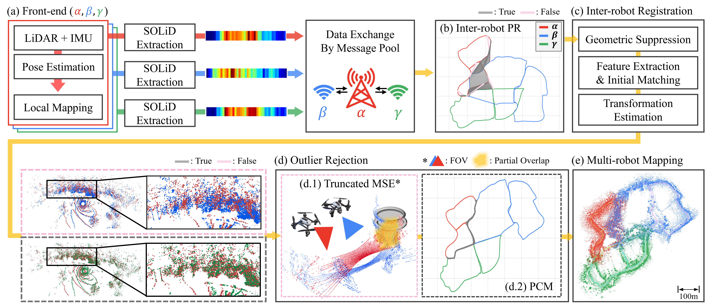

<div align="center">
  <h1>SKiD-SLAM</h1>
  <a href="https://github.com/sparolab/SKiD-SLAM"></a>
  <a href="https://github.com/sparolab/SKiD-SLAM"></a>
  <a href="https://github.com/sparolab/SKiD-SLAM"></a>
  <a href="#docker"></a>
  <a href="https://sparolab.github.io/research/skid_slam/"></a>
  <a href="https://arxiv.org/abs/2505.08230"></a>
  <br />
  <br />
  <p align="center"></p>
  <p><strong><em>Robust, lightweight, and distributed multi-robot LiDAR SLAM.</em></strong></p>

**[IEEE T-FR 2026]** SKiD-SLAM: Resource-Aware Distributed Multi-Robot LiDAR SLAM for Planetary Missions with Field Deployments at Analog Sites

Hogyun Kim<sup>1</sup>, Juwon Kim<sup>1</sup>, Dongjin Cho<sup>1</sup>, Jiwon Choi<sup>1</sup>, Geonmo Yang<sup>1</sup>, Seokhwan Jeong<sup>1</sup>, Jiyun Lee<sup>1</sup>, Miryeong Park<sup>1</sup>, Hyungtae Lim<sup>2*</sup>, Younggun Cho<sup>1*†</sup>

<sup>1</sup>[Spatial AI and Robotics (SPARO) Lab](https://sparolab.github.io/), Inha University &nbsp; <sup>2</sup>LIDS, MIT &nbsp; <sup>*</sup>Corresponding authors &nbsp; <sup>†</sup>PI
</div>

______________________________________________________________________

**SKiD-SLAM** = **S**OLiD + **Ki**SS-Matcher + **D**istributed SLAM.
Each robot runs its own LiDAR-inertial odometry. The robots share compact [SOLiD](https://github.com/sparolab/SOLiD) descriptors and find inter-robot loops with coarse-to-fine registration ([KISS-Matcher](https://github.com/MIT-SPARK/KISS-Matcher) → [small_gicp](https://github.com/koide3/small_gicp)). Pairwise consistency maximization rejects outlier loops before the maps are fused.

## :newspaper: News
* [25.04.29] Our paper has been selected for a spotlight talk!
* [25.04.17] Our paper is accepted at the ICRA 2025 Field Robotics Workshop.

______________________________________________________________________

## :package: Installation

### Docker

```bash
git clone https://github.com/sparolab/SKiD-SLAM.git
cd SKiD-SLAM
git submodule update --init
docker build -f docker/Dockerfile -t skid-slam .
```

Run it with your data mounted (X11 forwarding is only needed for RViz):

```bash
xhost +local:docker
docker run -it --rm --net=host -e DISPLAY=$DISPLAY \
  -v /tmp/.X11-unix:/tmp/.X11-unix \
  -v /path/to/bags:/data \
  skid-slam
```

### From source (ROS Noetic)

```bash
sudo add-apt-repository ppa:borglab/gtsam-release-4.0
sudo apt install libgtsam-dev libgtsam-unstable-dev libflann-dev liblz4-dev libtbb-dev

cd ~/catkin_ws/src
git clone https://github.com/sparolab/SKiD-SLAM.git
cd SKiD-SLAM && git submodule update --init
cd ~/catkin_ws && catkin_make -DCMAKE_BUILD_TYPE=Release
```

All third-party libraries ([SOLiD](https://github.com/sparolab/SOLiD), [KISS-Matcher](https://github.com/MIT-SPARK/KISS-Matcher), [small_gicp](https://github.com/koide3/small_gicp)) are pulled in as git submodules and built together with the package. Nothing has to be installed system-wide.

______________________________________________________________________

## :rocket: Run

```bash
roslaunch skid_slam run.launch config:=majang
rosbag play --clock majang.bag
```

| Argument | Default | Description |
| --- | --- | --- |
| `config` | `majang` | Dataset config in [`config/params/`](config/params): `majang`, `planetary_analog` |
| `robot0..2` | `jackal0..2` | Robot namespaces. `robot0` anchors the global map |
| `rviz` | `true` | Launch RViz |
| `save_poses` | `false` | Keyframe poses in the global frame (TUM format) |
| `save_map` | `false` | Downsampled feature map in the global frame |
| `save_whole_map` | `false` | Raw scans stacked at the global poses (`<robot>_whole_map.pcd`) |
| `save_scans` | `false` | Raw keyframe scans in the body frame (`scans/%06d.pcd`) |
| `save_dir` | `/tmp/skid_slam` | Results go to `<save_dir>/<robot>/` on shutdown |

Topics are namespaced per robot, e.g. `/jackal0/ouster/points` and `/jackal0/imu/data`.

### Record a video

[`scripts/run_bag.sh`](scripts/run_bag.sh) plays a bag, saves every result, and can render RViz headlessly (Xvfb + ffmpeg, both included in the Docker image) into an mp4:

```bash
scripts/run_bag.sh -c majang -b /data/majang.bag -o /data/results -v -s 4
```

`-s` sets the playback speed-up of the video. The camera slowly orbits the robots and zooms to keep all of them in view.

______________________________________________________________________

## :gear: Configuration

Each file in [`config/params/`](config/params) holds the full parameter set for one dataset:

- `skid_slam:` — single-robot LiDAR-inertial odometry: sensor, IMU, extrinsics, and export options.
- `mapfusion:` — the multi-robot part:
  - `solid` — descriptor
  - `retrieval` — candidate search and the `loop_threshold`
  - `registration` — KISS-Matcher and small_gicp settings, plus the `fitness_threshold`
  - `pcm` — outlier rejection

All parameters are read at runtime, so tuning never requires a rebuild. To use your own robot, copy the closest config, then set the topics, `N_SCAN`/`Horizon_SCAN`, and the IMU extrinsics.

> \[!NOTE\]
> Robot names must end with a single digit (`jackal0`, `jackal1`, ...). The digit is used as the robot index, and robot `0` defines the global frame.

______________________________________________________________________

## :books: Citation

If you use SKiD-SLAM in your research, please cite our [paper](https://arxiv.org/abs/2505.08230):

```bibtex
@article{kim2026skidslam,
  author    = {Kim, Hogyun and Kim, Juwon and Cho, Dongjin and Choi, Jiwon and Yang, Geonmo and Jeong, Seokhwan and Lee, Jiyun and Park, Miryeong and Lim, Hyungtae and Cho, Younggun},
  title     = {SKiD-SLAM: Resource-Aware Distributed Multi-Robot LiDAR SLAM for Planetary Missions with Field Deployments at Analog Sites},
  journal   = {IEEE Transactions on Field Robotics (T-FR)},
  year      = {2026},
}
```

## :pray: Acknowledgements

SKiD-SLAM builds on [LIO-SAM](https://github.com/TixiaoShan/LIO-SAM), [DiSCo-SLAM](https://github.com/RobustFieldAutonomyLab/DiSCo-SLAM), [SOLiD](https://github.com/sparolab/SOLiD), [KISS-Matcher](https://github.com/MIT-SPARK/KISS-Matcher), and [small_gicp](https://github.com/koide3/small_gicp). We thank the authors for open-sourcing their work.
